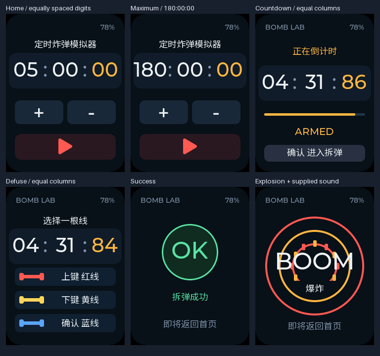

<p align="right">
  <a href="countdown-bomb.zh_CN.md">简体中文</a> · <strong>English</strong>
</p>

# Countdown Bomb: experimental application

[Application overview](../../README.md) · [Workspace and source history](readme.md)




## Accepted behavior

The card is a standalone countdown-and-defuse game. Two buttons adjust the
selected duration by one minute on a short press or five minutes on a long press;
the third starts the countdown. All timer pages use minutes : seconds : hundredths. Pressing
start again opens three wires, with the three buttons each selecting one wire.
Exactly one wire is correct per round. A wrong choice plays an explosion
animation and returns home, waiting for another round.

## Defaults used for unspecified details

- Initial duration: 5 minutes; clamped range: 1–180 minutes, without wrapping.
- UP increases, DOWN decreases, OK starts. In the wire page UP selects red,
  DOWN selects yellow, and OK selects blue; the screen labels show this mapping.
- The deadline continues while selecting a wire. Expiry explodes on either live page;
  an input arriving exactly at the deadline cannot win.
- The correct wire is selected once when starting each round. Rejection sampling
  removes modulo bias from the 32-bit random-word mapping. This is game randomness,
  not a security mechanism. An uninformed choice has a one-in-three success chance.
- Success lasts 1.8 seconds; explosion lasts 2.4 seconds so the supplied sound finishes
  before returning home automatically.
  The selected duration survives between rounds, but resets to 5 minutes on reboot.
- Setup UP/DOWN waits for release to apply one minute. The BSP long-start event
  (about 500 ms) instead applies five minutes once, clamped at the bounds; release
  never adds a sixth minute and holding does not auto-repeat. CLICK/DOUBLE aggregation
  events are ignored. Start and wire selection use immediate PRESS; holding or releasing
  never repeats them. The press opening the wire page does not cut a wire. Held keys
  at boot must be released before controls enable.
- The home screen keeps the application title, timer, +/− controls, a red play icon, and battery level.
  Branding, unit captions, and adjustment/start instruction labels are removed there.
  The seven-character Chinese title meaning "Countdown Bomb Simulator" sits above the timer.
- Three fixed timer columns show minutes, seconds, and exactly two fractional digits
  representing hundredths of a second (10 ms each), for example `04:31:86`.
  Each column is 68 px wide; centers are at x=40, 120, and 200 (80 px apart).
  Both separator gaps are 12 px and their colons are centered between digit groups.
  The 228 px timer panel is centered on screen, preserving the same 40 px font
  even for three-digit minutes.
  The value comes from the real remaining monotonic milliseconds, including second/minute
  borrowing. Unit captions below the digits are removed. The application loop polls at 20 ms and LVGL targets a 20 ms refresh period,
  updating only changed digit labels. Numeric text uses Montserrat 40; the play icon uses Montserrat 32. This targets up to 50 frames/s; it does not draw
  every millisecond or establish achieved panel frame rate.
- Wrong-wire and timeout explosions each queue the user-supplied `xm4167.mp3` effect once.
  The full recording is converted to 16 kHz / 16-bit mono PCM, with conservative peak
  attenuation and silent padding, without trimming or changing speed. Playback lasts
  1.920 seconds including padding, at a configured output volume of 75%.
- No networking, accounts, or persistent records are needed. The codec is
  suspended through BSP between effects. The home screen dims after 30 seconds without input;
  running rounds stay visible. The application does not enter deep sleep.

## Implementation boundaries

`main/bomb_game.c` owns pure state/deadline logic and the startup-release guard.
`main/main.c` queues BSP press/long/release events without blocking its shared timer callback;
its application loop reads the monotonic ESP timer, processes input, updates
battery readings, and renders under `bsp_lvgl_lock()`. It drops stale queued input
and reports queue drops. UI failure does not silently enable controls.

`main/bomb_ui.c` creates a new interface and never navigates to the baseline demo
menu. The retained demo source files are reference/test inputs and are excluded
from the application's CMake source list. The official BSP is unchanged.

The LVGL pool is 32 KiB and the main task stack is 8 KiB. The pool budget was
raised after the animation workload exhausted the smaller host pool; it is not
being used as a missing-glyph workaround. Real free heap, stack margin, power draw,
and largest contiguous block require hardware measurement. Bluetooth is disabled.

The 18 px Chinese font has 149 glyphs, including printable ASCII. Its 14,084-byte
4 bpp bitmap is in read-only Flash. The source is a retained Google Fonts Noto Sans
SC subset under [SIL OFL 1.1](../../assets/fonts/OFL.txt). Generation uses Pillow
12.3.0; [asset notes](../../assets/README.md) record regeneration and licensing.
The checker reparses emitted C data and verifies every bitmap pixel and cmap entry.
UI initialization also checks real LVGL glyph lookup, with U+9F98 as a negative control.

`main/bomb_sound.c` owns a persistent audio worker with a 4 KiB stack and priority 4.
The application loop queues only transitions into explosion, never animation frames.
The worker alone wakes/configures/writes/suspends the codec after startup. It streams
512-sample (1 KiB) chunks from read-only Flash, never holds an LVGL lock or references
screen objects, and blocks on I2S writes or its queue. The asset has at least 128 ms
of digital silence at its end to drain the documented 90 ms DMA queue before suspend.
Events delayed beyond 400 ms are discarded; playback stops producing data if it
passes the explosion deadline. Initialization or playback failures are logged while
the visual game continues. No new driver or MP3 decoder is installed on the card.

## Validation

- Game host tests cover short/long adjustment limits, no extra release action,
  ignored duplicate/stale edges, delayed scheduling, exact remaining milliseconds and ceil-rounded
  seconds, continuing deadlines on wire selection, expiry priority, all nine
  correct/chosen wire combinations, result timing, repeat play, unbiased mapping,
  and held/noisy startup-release samples.
- The baseline's main-specific deep-sleep wiring test is replaced by behavioral
  compilation/execution of this application's guard and game code. BSP and other
  baseline regression checks remain enabled.
- The same `bomb_ui.c` and font are compiled against the locked LVGL source for
  240×320 RGB565 host snapshots. All pages, the maximum duration without timer wrapping, millisecond borrowing, explosion phases,
  and 100 repeated page cycles are exercised with assertions enabled, including
  in Release builds. Host assertions abort rather than hanging on allocation failure.
- Host rendering proves software layout/font behavior, not panel output or device timing.
- The sound-worker test compares every output chunk with the retained PCM, checks
  non-blocking dispatch, single-event queue behavior, replay, stale/slow startup,
  wake/format/write/suspend failures, and queue/task allocation cleanup. Asset tests
  check WAV/PCM identity, format, amplitude, decay, and the silent DMA drain tail.
- An additional test compiles the actual `app_main` entry point with mocked BSP/RTOS boundaries. It exercises real callback-to-queue wiring, short/long/release classification and ignored click aggregation, noisy boot release, RNG rejection, win/loss/expiry/replay, UI-lock failure, stale input, idle dimming, battery fallback, and initialization failures. It does not emulate electrical behavior or RTOS scheduling on the card.

Run the full gate from an activated ESP-IDF 5.5.3 environment:

```sh
./tools/validate.sh
```

Optional repeatable UI preview after Managed Components have been downloaded:

```sh
cmake -S tests/bomb_ui -B .local/bomb-ui-build -DCMAKE_BUILD_TYPE=Release
cmake --build .local/bomb-ui-build
mkdir -p .local/bomb-preview
.local/bomb-ui-build/bomb_ui_preview .local/bomb-preview
```

### Current delivery (bomb-0.4.2)

- Build: PASS; Host tests: PASS; Device tests: PASS for flashing, startup, and the user-confirmed title/equal-spacing panel layout.
- ESP-IDF `v5.5.3`; complete `./tools/validate.sh` and separate archive verification passed.
- Merged image: `build/countdown-bomb-0.4.2-8de76e96-full.bin`, 1,032,752 bytes, offset `0x0`.
- Full-image SHA-256: `8de76e96aa6a510e438f0458d82c5f7f95917dbe982b18997bd4eb155232b9a6`.
- Matching ELF SHA-256: `f329d2947318447b64f6e745dc61328e2aff0c2be590d7de984ca7ac92754796`.
- Debug archive: `build/firmware/8de76e96aa6a510e438f0458d82c5f7f95917dbe982b18997bd4eb155232b9a6/`.
- All three timer pages use equal 68 px cells with centers at 40/120/200 and two
  equal 12 px separator gaps. The 228 px panel is symmetric on the screen; all
  values use the same 40 px font. The simulator title is retained.
- Real LVGL assertions confirm equal widths, center pitch, centered text and colons,
  symmetric outer margins, exact two-digit fractions/borrowing, and maximum-minute
  fit. All pages and 100 repeated cycles passed. Host LVGL usable pool 29,016 bytes,
  peak 20,528, free/largest block 14,208 bytes.
- The supplied audio PCM, sound code, controls, BSP and 75% volume are unchanged.
- Unverified: complete operation/repeated audio on this revision, full-duration expiry,
  runtime heap/stack, long-run stability and power.

- On 2026-10-30 (Asia/Shanghai), after explicit approval, this exact merged image
  was written from `0x0` to the ESP32-C3 v1.1 / 8 MB card on `/dev/cu.usbmodem114101`.
  Write-data hash verification passed; only the image range was erased, without a
  whole-chip erase. Startup confirms `bomb-0.4.2`, matching ELF prefix `f329d2947`,
  and ready display/LVGL/buttons/battery and sound worker. Possible reset when opening
  the USB log connection was explained beforehand. A 25-second startup observation showed
  no crash or reboot loop. The serial port was closed afterward; raw logs remain in ignored local storage.

- After flashing, the user confirmed normal display when asked to check the complete
  simulator title and equal spacing of the three digit groups on the physical card.

### Previous unflashed delivery (bomb-0.4.1)

- Build: PASS; Host tests: PASS; Device tests: NOT RUN for this revision.
- ESP-IDF `v5.5.3`; complete `./tools/validate.sh` and separate archive verification passed.
- Merged image: `build/countdown-bomb-0.4.1-8e671ef9-full.bin`, 1,032,816 bytes, offset `0x0`.
- Full-image SHA-256: `8e671ef9188bee9645b80363279af5c0672e22cfde564d697eea49e85e13f0aa`.
- Matching ELF SHA-256: `6216c4704035a49ec31bfe0406c6fc2fbb433bff03e42168c17247ea5b783c6c`.
- Debug archive: `build/firmware/8e671ef9188bee9645b80363279af5c0672e22cfde564d697eea49e85e13f0aa/`.
- Restores the user-requested seven-character Chinese simulator title at the top of
  the home screen. The font was regenerated and checked: 149 glyphs, 14,084 bitmap bytes.
  Real LVGL snapshots show the complete title above the timer; all pages, two-digit
  time/10 ms boundary checks, and 100 repeated page cycles passed. Host LVGL usable pool
  29,016 bytes, peak 20,528, free/largest block 14,208 bytes.
- The red play icon, minimal controls, two fractional digits, and audio code/PCM/75% volume
  are retained. This revision has not been flashed.
- Unverified: on-device title glyphs/layout and updated firmware behavior, repeated sound
  playback, full-duration expiry, runtime heap/stack, long-run stability and power.

### Previous device result (bomb-0.4.0)

- Build: PASS; Host tests: PASS; Device tests: PASS for this authorized flash and startup; user acceptance of the new panel layout is pending.
- ESP-IDF `v5.5.3`; the complete `./tools/validate.sh` gate and separate archive verification passed.
- Merged image: `build/countdown-bomb-0.4.0-434b8afa-full.bin`, 1,032,320 bytes, offset `0x0`.
- Full-image SHA-256: `434b8afa14b4e1bab3103e91b8eae654980e9a878f931863b3df7ec53cf88522`.
- Matching ELF SHA-256: `ddd0c0be7500af3f51de1011de93733772ce0f998fc925dd87e2a7e8ef05d048`.
- Debug archive: `build/firmware/434b8afa14b4e1bab3103e91b8eae654980e9a878f931863b3df7ec53cf88522/`.
- Home: timer, +/− buttons, red play icon, battery. All timer pages use enlarged 40 px
  digits and two hundredths digits. Host rendering covers `180:00:00`, borrowing,
  the `00`/`01` transition at 10 ms, all pages and 100 page cycles.
- Host LVGL usable pool: 29,016 bytes; peak 20,528; free/largest block 14,208 bytes.
- The embedded effect is byte-identical to the one confirmed audible on `bomb-0.3.0`;
  configured volume remains 75%. Sound code and BSP were unchanged in this revision.
- Unverified: this revision's panel readability, red icon, two-digit refresh, physical
  controls and repeated sound playback, full-duration expiry, runtime heap/stack and power.

- On 2026-10-30 (Asia/Shanghai), after explicit approval, this merged image was
  written from `0x0` to the ESP32-C3 v1.1 / 8 MB card on `/dev/cu.usbmodem114101`.
  Write-data hash verification passed; only the image range was erased, without a
  whole-chip erase. Startup confirms `bomb-0.4.0`, the matching ELF prefix, and ready
  display/LVGL/buttons/battery and sound worker. Possible USB reset when opening
  the startup log was explained beforehand. A 25-second startup observation found no crash or reboot loop,
  and the serial port was closed afterward. Raw flash/startup logs remain in ignored local storage.
  The user then requested restoring the application title; that follow-up is delivered separately.

### Previous device result (bomb-0.3.0)

- Build: PASS; Host tests: PASS; Device tests: PASS for flashing/startup and one user-confirmed audible explosion; extended acceptance remains pending.
- ESP-IDF `v5.5.3`; the complete `./tools/validate.sh` gate and separate archive verification passed.
- Merged image: `build/countdown-bomb-0.3.0-fe6515b7-full.bin`, 962,240 bytes, offset `0x0`.
- Full-image SHA-256: `fe6515b713ccf89bba4f783174e6ab365809d9d440f096aac8467805380847e6`.
- Matching ELF SHA-256: `98669089c16b96a0a6d1e0e120164e4efe60827990d546b19aae07ca32609b63`.
- Debug archive: `build/firmware/fe6515b713ccf89bba4f783174e6ab365809d9d440f096aac8467805380847e6/`.
- The delivered application binary contains the exact 61,440-byte converted user PCM once.
  Its source hash matches the supplied MP3; audio assets and conversion are documented
  in [asset notes](../../assets/README.md#countdown-bomb-explosion).
- Host tests passed game timing, short/long controls, exactly one sound trigger for
  wrong-wire/expiry and none for success, disabled-audio fallback, and real worker
  streaming/replay/failure handling. Real LVGL snapshots confirm the unit captions
  are removed, millisecond layout still fits, and 100 page cycles pass.
- Host LVGL usable pool: 29,008 bytes; peak 20,488; free 14,176; largest free block 13,520.
- Unverified: repeatable onset/tail timing with concurrent animation,
  repeated physical rounds, new panel layout/refresh and controls, full-duration expiry,
  runtime heap/stack, long-run stability and power.

- On 2026-10-30 (Asia/Shanghai), following explicit approval, this exact image was
  written from `0x0` to the ESP32-C3 v1.1 / 8 MB card on `/dev/cu.usbmodem114101`.
  Write-data hash verification passed. Only the image range was erased; no whole-chip
  erase was performed. Startup confirms `bomb-0.3.0`, the matching ELF prefix, and ready
  display/LVGL/buttons/battery and sound worker at volume 75%. Raw logs stay in ignored local storage. A 30-second startup window showed no crash
  or reboot loop. Reopening the native USB log connection reset the card; this was explained
  to the user. A subsequent 120-second observation captured codec wake/open at 16 kHz mono,
  about 1.9 seconds of playback, and successful verified suspend. The driver also logged
  already-disabled I2S-channel calls at transition boundaries; no application playback error
  was reported. After initially reporting no sound, the user confirmed normal playback
  at the existing configured 75% volume. No volume change was made, and the initial
  missing-sound report was not reproduced or assigned a speculative cause.

### Previous unflashed delivery (bomb-0.2.0)

- Build: PASS; Host tests: PASS; Device tests: NOT RUN for this revision.
- ESP-IDF `v5.5.3`; full `./tools/validate.sh` gate and separate archive verification passed.
- Merged image: `build/countdown-bomb-0.2.0-a33fd4ac-full.bin`, 894,720 bytes, offset `0x0`.
- Full-image SHA-256: `a33fd4ac54e1b73a6a902d8362eaf54260aa10dd37ff1bc42e367a5d3d9edc6c`.
- Matching ELF SHA-256: `cd9b5a7d64b201055746848cbc7eeccc3a8848ffaaf9e0ff8153b39ccbbdba06`.
- Debug archive: `build/firmware/a33fd4ac54e1b73a6a902d8362eaf54260aa10dd37ff1bc42e367a5d3d9edc6c/`.
- Real LVGL host rendering passed exact millisecond digits, second/minute borrowing,
  `180:00:000` without wrapping, all pages and 100 page cycles. With the same 32 KiB
  configuration, the host reported a usable pool of 29,008 bytes, peak use of 20,488,
  free space of 14,176, and a largest free block of 12,248 bytes. These are host values.
- The 20 ms application polling and configured LVGL refresh target remain unmeasured
  on the panel. This revision has not been flashed and needs separate authorization.
- Unverified: on-device millisecond readability/refresh, Chinese hint and millisecond digits,
  short/long adjustment and limits, full-duration expiry, long-run memory/stack and power.

### Previous delivery and device result (bomb-0.1.0)

- Build: PASS; Host tests: PASS; Device tests: PASS for flashing, startup, and the user-confirmed basic play flow below.
- Firmware version: `bomb-0.1.0`; ESP-IDF: `v5.5.3`.
- Full gate: `./tools/validate.sh` succeeded; the merged image and matching debug archive were independently reverified.
- Merged image: `build/countdown-bomb-0.1.0-c95c0cc4-full.bin`, 847,024 bytes, flash offset `0x0`.
- Full-image SHA-256: `c95c0cc4f45279e4197ece6ee8f9a0cd86758b0e708f73648cda34d691989cc9`.
- Matching ELF SHA-256: `fd815fde77a0c62d357db92677be89a77abfcdb55c9503ae7c45c711c5b3f25e`.
- Debug archive: `build/firmware/c95c0cc4f45279e4197ece6ee8f9a0cd86758b0e708f73648cda34d691989cc9/`.
- Host LVGL measurements: with a 32 KiB configuration, usable pool 29,016 bytes,
  peak 20,488 bytes, and free/largest block both 14,176 bytes after 100 cycles.
  These are 64-bit host measurements, not device heap or task-stack measurements.
- Two explosion times produced different pixels; all pages and 100 page cycles passed.
- `dependencies.lock` and the official `components/` BSP source match the pinned baseline.
- On 2026-10-30 (Asia/Shanghai), the user explicitly authorized flashing and testing. The verified image above was written at `0x0` to the sole discovered Espressif USB Serial/JTAG card on `/dev/cu.usbmodem114101`. The chip reported ESP32-C3 revision v1.1 and 8 MB Flash. Only the image range was erased/written; no whole-chip erase was requested or performed. Esptool reported successful write-data hash verification and reset the card.
- A 25-second bounded serial observation confirmed `bomb-0.1.0`, the matching ELF prefix, display/LVGL/button initialization, codec suspension, and entry to the ready loop. CW2017 reported 98% and 4,153 mV. No panic, watchdog, assertion, or reboot loop appeared in that window. The serial port was closed afterward; raw flash/startup logs remain in ignored local storage.
- The user reported no problems after checking readable Chinese and initial `05:00`, five-minute duration adjustments, starting the countdown, entering the wire page, and a wire-choice result followed by automatic return home. This confirms the observed basic flow; it does not establish that both random outcomes were seen.
- Nothing was committed, pushed, or published.

At that test, unverified: every page and maximum-duration layout, both random result branches,
full-duration expiry and countdown accuracy, button edge cases, animation timing,
long-run stability, runtime memory/stack, and power draw.

## Extended device acceptance still required

1. Check the Chinese hint, removed unit captions, colors, `180:00:00` width, and battery fallback on the panel.
   Confirm changing two-digit hundredths remain visible in both countdown and wire pages.
2. Verify short taps change one minute on release; holds change five minutes once at about
   500 ms, with no extra minute on release. Check rapid repeats, both bounds,
   no hold auto-repeat, and a key held during startup.
3. Start a round, enter wires, and confirm the entry press does not cut a wire.
   The visible countdown must continue there.
4. Verify correct-wire success, wrong-wire explosion, expiry on both live pages,
   automatic return, and a fresh round with the chosen duration.
5. Listen to the supplied effect on wrong-wire and timeout explosions: one playback,
   clear onset and complete tail, no replay on repeated frames, and clean repeat rounds.
   Confirm silent success and continued button/animation responsiveness.
6. Observe the full explosion animation, input recovery, idle dimming, and runtime
   memory/stack/power behavior. A small number of random rounds cannot establish
   an exact statistical one-third rate.

The merged image is for offset `0x0`; it replaces the installed application and
can reset NVS settings. The exact image and target require explicit approval
before device testing. Existing official baseline artifacts remain in their own
content-addressed archive.
